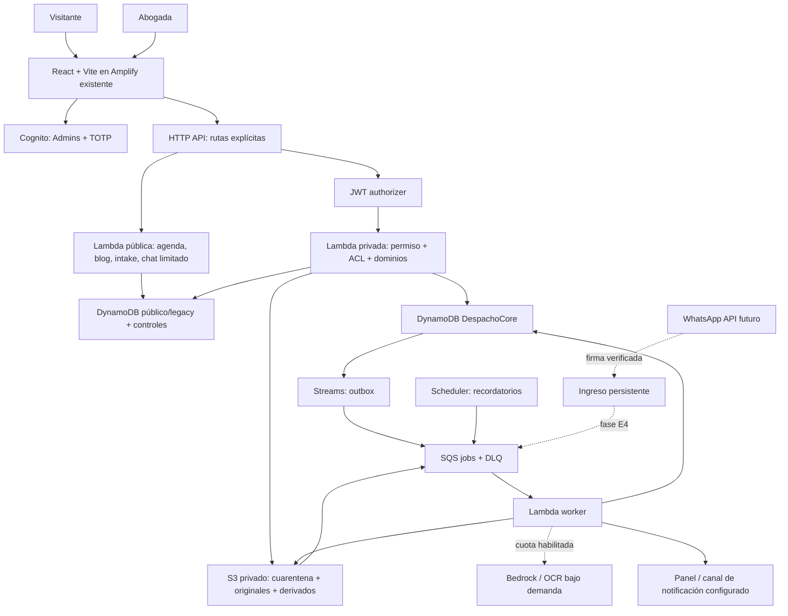

# Design — Arquitectura y contratos

Estado: diseño para implementar; ningún recurso creado por esta spec. Requisitos: [requirements.md](requirements.md). Tareas: [tasks.md](tasks.md). Costos/fuentes: [cost-model.md](cost-model.md). Fecha: 2026-10-13.

## 1. Decisiones de arquitectura

| ADR | Decisión | Razón / consecuencia |
|---|---|---|
| LC-01 | DynamoDB PAY_PER_REQUEST como base del núcleo | Reutiliza stack y elimina cómputo de BD siempre activo; exige diseñar consultas, invariantes y agregados explícitamente |
| LC-02 | Backend modular, inicialmente API pública + API privada + worker | Separación de privilegios, sin Lambda por cada tabla; biblioteca de dominio compartida |
| LC-03 | Lambda fuera de VPC, sin NAT/provisioned concurrency | Evita capacidad fija; medir cold starts y usar jobs para trabajo largo |
| LC-04 | S3 privado, versionado, SSE-S3 y DynamoDB con clave propiedad AWS por defecto | Cifrado sin CMK dedicada mensual; KMS propio sólo ante requisito concreto de control, no por defecto |
| LC-05 | Sin Aurora/Neptune/OpenSearch/GraphRAG en MVP | SQL del plan anterior queda como referencia conceptual, no migración a ejecutar |
| LC-06 | Biblioteca por árbol + metadatos antes de búsqueda integral/RAG | Satisface navegación de la abogada con costo de almacenamiento/consultas; no promete FTS sobre DynamoDB |
| LC-07 | Colas SQS y worker invocado por eventos | Jobs idempotentes, reintentos limitados y DLQ; Step Functions sólo si la orquestación posterior lo justifica |
| LC-08 | WhatsApp manual primero; API directa candidata para fase E4 | Evita suscripción y recargo del intermediario, pero agrega mantenimiento webhook; comparar con AWS EUM usando volumen real |
| LC-09 | IA optativa y medida por operación | CRM y expedientes siguen disponibles cuando se suspende IA |
| LC-10 | Recuperación y controles desde E0 | No ahorrar eliminando permisos, PITR o validación de archivos |
| LC-11 | MFA OPTIONAL por decisión explícita del usuario (2026-10-14) | Cuenta administradora actual inscrita y login TOTP confirmado; recuperación probada con MFA ON en staging. La política OPTIONAL permite usuarios sin factor y no garantiza MFA global. No cambiar a ON sin nueva autorización |

La elección de DynamoDB y costo mínimo sigue la preferencia del usuario. Cualquier servicio con piso mensual nuevo requiere actualizar ADR y mostrar efecto económico; no se introduce silenciosamente durante implementación.

## 2. Componentes y límites de confianza



PUB no lee expedientes/documentos privados. ADM no acepta actor/tenant/rol del body. Worker no publica archivos ni envía mensajes por decisión del modelo sin políticas. Tabla/prefijos IAM separan datos públicos e internos. Las Lambdas comparten módulos, no un rol IAM omnipotente.

Separación propuesta dentro del repositorio, a crear al implementar:

```text
infrastructure/
  main.tf + módulos/variables por entorno
  lambda_api/
    public_handler.py / admin_handler.py / worker_handler.py
    auth/       validación de claims y autorización
    domains/    crm, agenda, documents, workflows, finance, chat
    storage/    repositorios DynamoDB/S3; ningún acceso directo desde UI
    contracts/  entradas/salidas, errores y validadores
frontend/src/
  api/          cliente HTTP, sesión, errores y cursores
  features/     crm, cases, calendar, library, finance, web, settings
scripts/        migración, reconciliación, exportación y restore
tests/          unitarias offline + integración staging separada
```

Mantener el handler actual hasta cerrar acceso; extraer módulos por comportamiento, sin reescritura total previa a seguridad. Empaquetar dependencias Python con uv/lock y activar `.venv\Scripts\activate`; versión Lambda y build deben ser compatibles.

## 3. Identidad y rutas

Gateway JWT valida issuer/audience/expiración. Frontend envía access token de Cognito; backend exige `token_use=access`, client_id esperado y `cognito:groups` con Admins. No aceptar un ID token como autorización administrativa. Inspeccionar configuración real del app client y claims en staging. Middleware común garantiza grupo y permiso por recurso antes de acceder al repositorio.

MFA TOTP: implementar enrollment, challenge, nuevo password cuando corresponda, renovación y recuperación administrativa antes de activarlo. No guardar contraseñas en scripts ni en logs. Evitar datos privados cacheados tras logout; preferir tokens de corta duración y limitar persistencia en navegador. Almacenamiento de token no sustituye permiso servidor.

Implementación E0: enrollment/challenge y recuperación verificados. Mantener pool OPTIONAL conforme a LC-11, con TOTP habilitado en la cuenta actual. El reset administrativo del factor se prueba sólo en staging; nunca desactivar factores reales para probar recuperación.

| Superficie | Público permitido | Privado / acción |
|---|---|---|
| Agenda | GET availability, POST appointments validado | GET/PATCH appointments bajo `/api/admin`; sin status público |
| Blog | GET lista/slug publicados | CRUD/previsualizar borrador sólo admin |
| Horarios | GET horario publicable | PUT admin |
| Pro bono | POST limitado/minimizado | GET/PATCH admin |
| Leads | POST intake controlado | GET/POST/PATCH/DELETE admin; eliminar lecturas públicas y alias |
| Chat | POST con cuota, payload acotado y sesión firmada | Leads/sesiones no listables públicamente |
| Documentos | Ninguna descarga privada pública | Subida, finalización, listar, firmar descarga y exportar con ACL |

Rutas antiguas administrativas devuelven 401/403 mientras migra UI, luego 404/410; nunca quedan abiertas. `/api/{proxy+}` deja de admitir operaciones por defecto. CORS restringido ayuda al navegador; no cuenta como autenticación.

## 4. Modelo lógico y físico DynamoDB

Tablas legacy conservadas al principio: Appointments, AvailabilityBlocks, BlogPosts, ProBonoRequests, ChatLeads, ChatSessions. Nuevas: `DespachoCore` (entidades privadas y relaciones) y `OperationControl` (idempotencia, cuotas, locks cortos). Las tablas on-demand no agregan cómputo fijo por cantidad, pero almacenamiento, índices y PITR sí cuestan.

`DespachoCore`: PK/SK string, `entity_type`, `schema_version`, `version`, `created_at`, `updated_at`, actor `sub`. Importes en unidades menores enteras con moneda ISO; tiempos ISO UTC más zona donde corresponde. IDs opacos sin nombres/CI en claves S3. Campos de ejemplos son contratos, no datos para cargar.

| Entidad | PK | SK / relaciones |
|---|---|---|
| Persona | PERSON#id | META, CONTACT#id; contacts incluyen valor y verificación, no teléfono UNIQUE |
| Cliente | PERSON#id | CLIENT; condición comercial separada de persona |
| Oportunidad | OPP#id | META, STAGE#timestamp#event_id, INTERACTION#id |
| Caso | CASE#id | META, PARTY#role#person_id, EVENT#timestamp#id, STEP#id, TASK#id |
| Relación persona→caso | PERSON#id | CASE#case_id#role, escrita en misma transacción que PARTY |
| Honorarios/cuotas | CASE#id | AGREEMENT#id, INSTALLMENT#id |
| Pago/gasto | CASE#id | PAYMENT#id, EXPENSE#id, ALLOCATION#payment_id#quota_id, REVERSAL#id |
| Documento | DOC#id | META, VERSION#n, LINK#case_id; el caso guarda DOC#doc_id como vínculo inverso |
| Taxonomía | TAXON#id | META con parent_id y etiqueta; paths se derivan, no son identidad |
| Workflow | WORKFLOW#id | META, VERSION#n, STEP#version#id |
| Métricas | METRIC#period#dimension | VALUE#name, APPLIED#event_id |
| Auditoría | AUDIT#yyyy-mm-dd | timestamp#event_id; actor, acción, referencias y diff minimizado |
| Outbox | OUTBOX#event_id | META con destino/tipo/status/next_attempt |
| Configuración | CONFIG#despacho | BUDGET, POLICY#version, CHANNEL#id, tarifas reales versionadas |

Un solo despacho en MVP. No afirmar multi-tenant: introducir aislamiento tenant en otra ADR antes de alojar otro negocio. Se permiten varios clientes/representados/pagadores por caso; autorización es por despacho/rol ahora y por recurso cuando se abra portal/pasante.

### Índices y patrones de acceso

GSI1 (`gsi1pk`, `gsi1sk`) para listados; GSI2 (`gsi2pk`, `gsi2sk`) para búsquedas por nombre normalizado. Proyectar IDs y campos mínimos, no relatos ni binarios. Consultas de índices son eventualmente consistentes: después de guardar leer por PK/SK para mostrar el resultado inmediato.

| Consulta | Patrón |
|---|---|
| Personas por nombre/prefijo | GSI2: PERSON_NAME#prefijo acotado, SK nombre_normalizado#id; tokenizar nombres/apellidos en ítems de búsqueda si se requieren varios prefijos |
| Contacto exacto compartido | Ítems CONTACT_LOOKUP#hash_normalizado / PERSON#id; Query puede devolver varias personas; restringir este índice a backend privado |
| Oportunidades por etapa | GSI1pk OPP_STAGE#stage, SK created_at#id; intervalos/paginación |
| Casos por estado | GSI1pk CASE_STATUS#state, SK updated_at#id |
| Casos de persona / expediente | Query PERSON#id por CASE# y CASE#id por prefijo de SK |
| Archivos en rama/colección | GSI1 sobre ítems de vínculo: LIBRARY#collection#taxon_id / title_normalizado#doc_id |
| Hijos del árbol | GSI1pk TAXON_PARENT#id / order#label#id |
| Vencimientos por fecha | GSI1pk DUE#yyyy-mm, SK timestamp#task_id; obtener registro base y versión antes de notificar |
| Slug blog público | Ítem de mapeo de slug único a post; lectura de post confirma published antes de devolver |
| KPI por período | Get/Query METRIC#period#dimension; no calcular desde página visible del Kanban |

Ramas descendientes: paginar hijos y resultados con límite de nodos; no un scan completo encubierto. Búsqueda MVP usa título/prefijo/tags y filtros; no asegura fuzzy ni full-text. Conflictos combina identificador exacto, contactos y candidatos por nombre; similitud en candidatos sirve de ayuda, no dictamen.

No persistir arrays ilimitados de notas/pagos/mensajes ni documentos enteros en un ítem. Relatos largos/derivados van a S3 con ACL; todos los límites de tamaño del contrato deben ser inferiores al límite DynamoDB. Relaciones no tienen FK nativas: repositorio comprueba existencia/versión con condiciones transaccionales; borrado lógico evita huérfanos.

## 5. Transacciones, concurrencia e idempotencia

Todas las creaciones sensibles reciben `Idempotency-Key`. Registro durable en OperationControl por actor/ruta/key con hash del payload, estado y resultado/IDs; clave reutilizada con payload distinto →409. TTL es limpieza tardía: la aplicación comprueba expires_at. Para pagos y migración mantener además clave de negocio duradera; la expiración de idempotencia no habilita duplicar un cobro.

**Alta:** reservar IDs; transacción comprueba persona/versión, decisión de conflicto y escritura de persona si nueva, oportunidad o caso, vínculos, auditoría y outbox. Máximo de partes admitido en alta rápida mantiene operación bajo 100 acciones/4 MB; más partes se incorporan luego a borrador con comandos idempotentes. No marcar ACTIVE hasta completar requisitos. Mismo ítem no recibe ConditionCheck separado más Update en la misma transacción: condición va en la escritura.

**Cita:** agregar tabla `BookingSlots` on-demand o patrón compatible dedicado; PK `professional_id#local_date`, SK `time#duration`. En MVP duración única configurada. Transacción crea slot con attribute_not_exists, cita con estado fijo, idempotencia y auditoría/outbox. Duraciones variables requieren reservar todos los bloques en una única transacción. No usar DateIndex como lock. Reprogramar comprueba propietario/versión y mueve lock; cancelación libera sólo el slot del mismo appointment_id. Horarios se validan contra versión leída y comprobada al escribir.

**Edición:** `version = expected_version`; actualizar y sumar versión dentro de escritura condicional. Notas son eventos append-only. Estado y referencias se validan en servidor.

**Pagos:** pago conciliado, asignaciones y saldos de cuotas se actualizan atómicamente, con condición de versión y no-sobreasignación. Mantener residual no asignado explícito. Pago en moneda distinta exige conversión registrada; no cast implícito. Ajuste genera movimiento inverso y recalcula saldos con las mismas garantías.

**Outbox:** evento nace en la transacción de negocio. Streams filtra OUTBOX pendiente y encola evento; entrega al menos una vez. Worker guarda marcador duradero por consumidor+event_id y actualiza efecto+marcador atómicamente si ambos son DynamoDB. Job programado de conciliación busca pendientes por índice acotado para recuperar pérdida fuera de retención del stream. Éxito de escritura no depende de correo/IA/WhatsApp.

Efectos externos no son exactamente una vez por tener SQS: timeout tras envío puede dejar resultado desconocido. Guardar request/provider_id, consultar estado donde sea posible y mandar a revisión cuando no se pueda distinguir entrega de fallo; no reintentar ciegamente mensajes/pagos.

## 6. API y frontend

Transición E0 (2026-10-14): para no romper consumidores actuales, las rutas legacy conservan campos planos (`appointments`, `posts`, `leads`, etc.) y añaden request_id, version y next_cursor; errores usan error/code/request_id. El envelope `data/error` siguiente es el objetivo para dominios nuevos E1, que deben versionarse o migrar consumidores coordinadamente. No cambiar formatos sólo en backend. UI pública/privada consume cursores con límite de páginas y muestra error cuando falla, sin convertirlo en cero.

Éxito: `{data, request_id, version?, next_cursor?}`; job: 202 con `{job_id,status_url}`. Error: `{error:{code,message,fields?,retryable},request_id}`. 401/403 identidad/permiso, 404 inexistente, 409 conflicto, 413 tamaño, 422 validación, 429 cuota, 503 dependencia. No exponer excepción de boto3.

| Método/ruta nueva | Comportamiento |
|---|---|
| GET/POST `/api/admin/personas`; PATCH `/{id}` | Búsqueda, alta, versión; candidatos no fusión automática |
| GET `/api/admin/conflictos` | Búsqueda privada; respuesta lista de candidatos y alcance, nunca certificado |
| GET/POST/PATCH `/api/admin/oportunidades[/{id}]` | Etapas con historial; perder exige motivo |
| POST `/api/admin/intake` | Alta transaccional; conflicto revisado o caso en borrador |
| GET/PATCH `/api/admin/casos/{id}` | Vínculos, estado, responsable y versión |
| POST `/api/admin/casos/{id}/pagos` | Pago/asignaciones; no confirmación por captura |
| POST `/api/admin/documentos/uploads` | Validar metadata, asignar key y permiso restringido de subida |
| POST `/api/admin/documentos/{id}/complete` | Verificar objeto/version/tamaño/checksum y encolar una sola ingesta |
| POST `/api/admin/documentos/{id}/download` | ACL + versión limpia + audit → URL firmada |
| GET `/api/admin/biblioteca` | Árbol/filtros/cursor; nunca lista S3 directa en navegador |
| POST `/api/admin/casos/{id}/workflow` | Instanciar versión validada; misma key no duplica pasos |
| GET `/api/admin/metricas` | Período/moneda/fecha de cálculo y datos disponibles |
| POST `/api/admin/casos/{id}/export` | Job privado, enlace temporal, manifiesto |
| POST `/api/admin/intake/estructurar` | Opcional; cuota, resultado propuesto y editable |

Navigation: Inicio (tareas reales), Alta rápida, Embudo, Personas/clientes, Casos, Agenda, Biblioteca, Finanzas, Web, Configuración; Bandeja WhatsApp sólo si API activada. Panel de caso: resumen/partes, pasos, documentos, agenda, finanzas y eventos. Formularios accesibles, móvil, estados loading/empty/error explícitos; al fallar API conservar edición y no fabricar ceros. Lazy routes para admin/chat; no usar datos semilla del despacho sin validación.

## 7. Biblioteca e ingesta segura

S3 privado: `quarantine/doc_id/upload_id`, `originals/doc_id/version_id`, `derived/doc_id/version_id/processor_version`, `exports/job_id`. Block Public Access, TLS requerido, ACL deshabilitada, versioning; identidades IAM mínimas. Presigned POST con límites de tamaño/tipo y key exacta, breve expiración; MIME real se comprueba en worker.

Parámetros técnicos iniciales propuestos: máximo 20 MiB/upload y 200 páginas/job; URL de descarga 5 minutos. Son límites de producto ajustables con medición, no datos del negocio. Guardar S3 VersionId y checksum; object event puede repetirse y no significa upload aprobado.

Estados: UPLOADING → QUARANTINED → SCANNING → CLEAN → EXTRACTING → READY; ERROR/REJECTED requieren causa/reintento. Download sólo CLEAN/READY según uso; extracción sólo CLEAN. Persistir transición condicional por versión del pipeline. Antivirus por job en Lambda container con firmas actualizadas y límites de recursos; validar viabilidad con corpus real. Si no cabe en Lambda, job Fargate puntual o servicio gestionado medido bajo ADR; archivos permanecen bloqueados hasta resultado. No usar preview del navegador como antivirus.

PDF textual/DOCX/MD: extracción local del worker sin modelo. OCR sólo escaneados, bajo cuota y aprobación de lote; conservar original siempre. Primera fase clasificación manual + etiquetas; sugerencia IA posterior. Plantillas DOCX rellenadas con docxtpl, variables escapadas y revisión; no ejecutar macros ni código de archivo subido.

Un checksum repetido propone reutilizar blob interno, pero cada vínculo conserva ACL y caso; no revelar que el mismo archivo existe en otro expediente. Retención y borrado abarcan versiones S3, texto, índices y exportaciones. No purgar expedientes sin política profesional validada. Exportaciones temporales sí tienen expiración independiente.

## 8. Procedimientos, recordatorios y métricas

Workflow publicado inmutable; copiar pasos al caso y permitir cambios locales auditados. Crear un plazo requiere fuente/evento/fecha confirmados; la IA sólo propone. Empezar con registro manual y recordatorios; calculadora por materia sólo con reglas y pruebas de la abogada.

Scheduler ejecuta una revisión horaria de tareas por fecha/mes con watermark durable y lookback para caídas; nunca depender sólo de «hoy» para recuperar alertas atrasadas. Dedupe por task_id/version/offset/channel. Antes de enviar comprobar estado actual, vencimiento y consentimiento; modificación del plazo invalida versión antigua. El panel muestra atrasos aun sin correo. Canal SES/SNS requiere destinatario/configuración y prueba de entrega; no declarar listo al crear topic. ICS privado con token revocable y datos minimizados, posterior al núcleo.

Métricas E1: conteo por etapa, casos activos, pactado/cobrado, saldo y vencido por moneda. Eventos actualizan agregados con marcador APPLIED; reconciliación bajo petición reconstruye desde índices de período, paginada, con job y límite. No full scan por request. E3 añade cohortes, canal y tiempos; CAC exige gasto atribuible; rentabilidad exige tiempo/costo. Distribución de ingresos por canal usa oportunidad de origen única por contratación o regla de atribución explícita; varios pagos no multiplican oportunidades.

## 9. IA, WhatsApp y RAG con interruptores

Flags independientes: ai_public_chat, ai_intake, ocr, wa_api, rag_public, rag_private. Por defecto las capacidades nuevas costosas están apagadas; el chat actual recibe límites o modo determinista según cuota configurada. Persistir preferencias y auditoría; IAM restringe modelos/perfiles autorizados.

Cada llamada reserva máximo estimado (entrada + maxTokens + segunda llamada posible) de una cuota diaria/mensual mediante condición atómica. Contabilizar uso real; timeout desconocido conserva reserva hasta reconciliación. Tarifas versionadas/configuradas; límites por usuario/sesión más cuota global. Presupuestos de IA distintos de recordatorios de plazos: apagar IA no elimina avisos operativos. Alertas AWS Budgets son complementarias y tardías, no interruptor de factura.

Chat: sesión aleatoria firmada/expirable, mensajes limitados, lock/versión por conversación, turnos completos. Máximo de iteraciones de herramientas explícito; resultado de error correcto; leads idempotentes por conversación/intake. FAQ y datos de horarios deterministas. El prompt no autoriza operaciones. No persistir «estado emocional» inferido como hecho clínico; sólo observación opcional minimizada y revisada.

WhatsApp E4: elegir proveedor después de prueba de coexistence y costos. API directa: verificar challenge y firma del body crudo, proteger secretos, persistir evento por message_id antes de ACK rápido; trabajo asíncrono. Si se usa EUM: SNS estándar, cola estándar y adaptador a FIFO por conversación cuando se requiera serialización. Estados BOT/HANDOFF_PENDING/HUMANO/CERRADA con versión. Toma de control usa el mismo mecanismo de exclusión que salida; envío ya aceptado por proveedor puede no cancelarse y se informa. Adjuntos pasan cuarentena. Estado de caso se limita a eventos explicitamente compartibles y autorización vigente.

RAG E4: primero corpus público autorizado separado; luego interno. Elegir almacenamiento vectorial por prueba de costo/recall; S3 Vectors es candidato a estudiar, no recurso comprometido. No requiere adoptar Aurora para CRM. Guardar modelo/dimensión/versiones y reindexación acotada. Filtros de acceso impuestos por servidor en recuperación y toda expansión; documento citado debe seguir disponible/autorizado al responder. Validación de citas y vigencia con abstención. GraphRAG sólo tras demostrar mejora sobre búsqueda simple. Dictado de voz queda pendiente de revisión del proveedor/procesamiento del navegador; no asumir local ni privado por usar Web Speech API.

## 10. Migración, operación y verificación

Primero inventariar AWS en lectura y respaldo. Cerrar accesos actuales antes de crear tablas de expedientes. Infra por entorno con state S3 cifrado/versionado/locking y roles separados; no versionar state/secretos. Conservar `.terraform.lock.hcl`; evitar auto-apply y recreación de Cognito/tablas para renombrar.

Migración ChatLeads: snapshot, mapping stage y moneda documentado, idempotencia por legacy_lead_id, dry-run con conteos/diferencias sin PII, importar, reconciliar, corte de escrituras y verificación final. No mantener doble escritura indefinida. Antigua tabla sólo lectura tras corte; rollback antes del corte usa legacy, después requiere replay de cambios nuevos y plan probado. Citas existentes necesitan reconciliar slots: duplicados quedan en revisión, no se eliminan automáticamente.

Logs con request_id/operation_id/event_id, código y duración; no relatos/tokens/archivos/teléfonos. Métricas de 401/403, errores, colas atrasadas, cuota y gasto por operación; pocas alarmas útiles con costo incluido. PITR para datos críticos, versionado S3 y restauración a entorno aislado. Objetivos propuestos a validar: RPO ≤24 h para desastre completo, RTO ≤1 jornada laboral; recuperación lógica con PITR según ventana configurada. Evitar prometer continuidad multirregión sin recursos correspondientes.

Pruebas: unitarias de transiciones/dinero/validación; integración staging de IAM, transacciones concurrentes, GSI eventual, URLs S3/ACL y restore; extremo a extremo de jornada real autorizada. Fixtures sintéticos sólo offline/staging identificados, no datos de UI productiva. Cada propiedad de la [matriz](traceability.md) tiene evidencia antes de marcar tarea completa.

Objetivos técnicos propuestos: p95 lectura admin ≤1.5 s y escritura ≤2 s en región/volumen medidos, sin IA ni cold start; medir cold start aparte, no ocultarlo. Jobs visibles con estado en ≤2 s tras aceptación. API no espera OCR ni extracción larga; entradas grandes devuelven 413 o job acotado. No se promete SLA de IA ni de proveedor externo.

## 11. Criterios para reconsiderar arquitectura

Evaluar PostgreSQL cuando necesidades reales de relaciones/reportes ad hoc hagan más costoso mantener agregados que una BD relacional; comparar gasto total y horas de desarrollo. Evaluar índice de texto/vector cuando biblioteca por metadata no cumpla búsquedas reales. Evaluar worker distinto si límites medidos impiden completar archivos frecuentes. Registrar problema, benchmark, alternativa y costo antes de cambiar; cantidad arbitraria de documentos no decide por sí sola.
